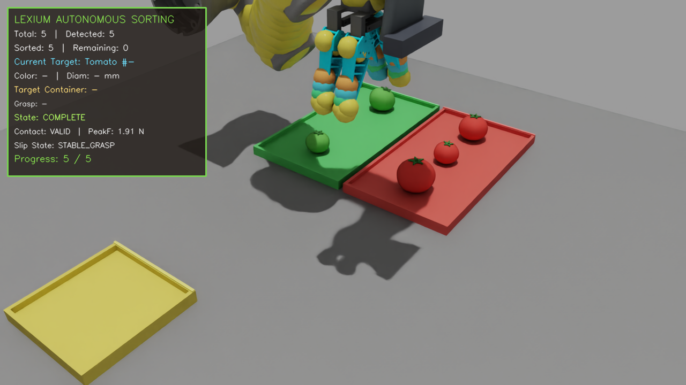
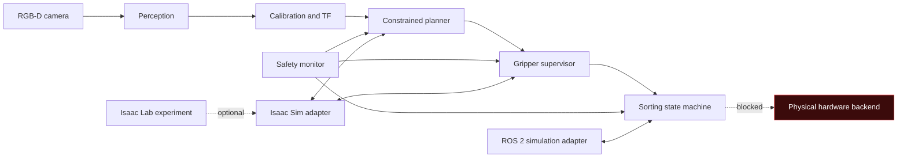

<div align="center">

# Lexium Agro

### Autonomous Mobile Manipulator for Hydroponic Greenhouses

**RGB-D perception · collision-aware manipulation · adaptive four-finger grasping · simulation-first validation**

[](https://github.com/ravonek/Lexium_cobot/actions/workflows/offline.yml)
[](https://www.python.org/)
[](isaac_sim/README.md)
[](ros2/README.md)
[](docs/SAFETY.md)
[](docs/STATUS_AND_PROVENANCE.md)

[Project specification](PROJECT_SPEC.md) ·
[Architecture](docs/ARCHITECTURE.md) ·
[Validation report](docs/VALIDATION_REPORT.md) ·
[Safety](docs/SAFETY.md) ·
[Thesis](thesis/README.md)

</div>

---

## Overview

Lexium Agro is a KBTU diploma research project exploring a control system for an
autonomous mobile manipulator in hydroponic greenhouses. The target platform
combines a six-axis Schneider Electric Lexium Cobot, an eight-wheel omnidirectional
base, an RGB-D camera, and a four-finger adaptive gripper.

The intended pipeline is:

```text
RGB-D acquisition → fruit detection → metric 3D localization → constrained planning
        → gentle grasp → lift and transfer → classification and sorting → metrics
```

This repository is deliberately evidence-driven. Historical screenshots, terminal
transcriptions, source archives, and newly executed offline tests are kept separate.
A simulation demo is not presented as a physical-robot result, and scripted motion
is not presented as reinforcement learning.

<table>
  <tr>
    <td align="center" width="50%">
      
      <br /><sub><b>Physical prototype:</b> upright Lexium Cobot on the mobile platform</sub>
    </td>
    <td align="center" width="50%">
      
      <br /><sub><b>Simulation evidence:</b> one recorded Stage 6 sorting scene</sub>
    </td>
  </tr>
</table>

## Current status

| Area | Evidence available | Status |
|---|---|---|
| Repository and offline domain layer | Hash inventory, CI, 30 offline tests, lint and strict typing | ✅ Reproducible |
| Physical platform | Assembly photographs and gripper prototype media | 🟡 Assembled prototype |
| Stage 6 sorting | One supplied simulated scene showing 5 targets / 5 sorted | 🟡 Historical evidence; raw report missing |
| Phase 10 validation | Supplied terminal transcription of five passing scenarios | 🟡 Not yet rerun from source |
| RGB-D perception | Earlier HSV/cube work; TinyUNet mentioned in historical log | 🟠 Current model and calibration missing |
| Isaac Sim / Isaac Lab | Historical source and video artifacts | 🟠 Latest Ubuntu workspace required |
| Reinforcement learning | No verified checkpoint, curves, or evaluation bundle | ⚪ Not evidenced |
| ROS 2 and mobile integration | Architecture and adapter plan | ⚪ Planned |
| Autonomous physical harvesting | No safety-approved end-to-end trial | ⛔ Not authorized |

See [status and provenance](docs/STATUS_AND_PROVENANCE.md) for the precise evidence
boundary and [validation report](docs/VALIDATION_REPORT.md) for commands actually run.

## System architecture



Implemented today is the dependency-light offline layer: fail-closed configuration,
sorting decisions, state transitions, RGB-D pinhole projection, rigid transforms,
metrics, deterministic seeds, structured logging, and a permanently disabled
hardware backend. Isaac/ROS adapters remain integration boundaries until the current
Ubuntu source and installed API versions are inspected.

## Quick start

Requirements: Python 3.10 or newer. The commands below run offline only and do not
import Isaac, ROS, or any physical controller driver.

```bash
git clone https://github.com/ravonek/Lexium_cobot.git
cd Lexium_cobot

python3 -m venv .venv
.venv/bin/python -m pip install -e '.[dev]'

.venv/bin/python scripts/verify_handoff.py
.venv/bin/python -m ruff check src tests scripts
.venv/bin/python -m mypy src/lexium_agro
.venv/bin/python -m pytest -q
.venv/bin/lexium-agro-dry-run
```

Expected offline test result at the current revision:

```text
30 passed
```

These are new scaffold tests, not the missing historical suite described as 20/20
in the Phase 10 terminal transcription.

## Repository map

| Path | Purpose |
|---|---|
| [`src/lexium_agro`](src/lexium_agro) | Offline-safe domain layer and typed integration contracts |
| [`tests`](tests) | Dependency-light tests runnable without a GPU |
| [`configs`](configs) | Fail-closed default configuration; hardware disabled |
| [`assets/robot`](assets/robot) | Older robot references pending revision validation |
| [`isaac_sim`](isaac_sim) | Simulator integration plan and compatibility boundary |
| [`isaac_lab`](isaac_lab) | Experimental learning path; no verified policy claim |
| [`ros2`](ros2) | Planned ROS 2 Jazzy simulation adapters |
| [`legacy`](legacy) | Preserved historical source, reports, and original archives |
| [`evidence`](evidence) | Screenshots and explicitly labelled transcriptions |
| [`media`](media) | Project photographs, videos, presentation, and documents |
| [`thesis`](thesis) | KBTU thesis draft and figures |
| [`docs`](docs) | Architecture, migration, safety, provenance, and validation |

## Evidence and reproducibility

The handoff inventory contains 214 declared source files plus its manifest. Run:

```bash
.venv/bin/python scripts/verify_handoff.py
```

The verifier checks every declared byte size and SHA-256 digest and validates all
four nested ZIP archives. Integrity does not prove an experiment succeeded; it only
proves the preserved artifact matches the supplied handoff.

Key reporting rules:

- Stage 6 `5/5` refers to one simulated five-object scene.
- Phase 10 `5/5` refers to five validation scenarios; one scenario handled three objects.
- Simulation force and torque values are not certified physical limits.
- No checkpoint means no learned-policy claim.
- Every percentage must retain its numerator, denominator, scenario, and seed.

## Recovering the current Ubuntu workspace

The latest Stage 6/Phase 10 sources and raw reports were not present in the handoff.
On the original Ubuntu workstation, from this repository, run:

```bash
python3 scripts/collect_workspace.py \
  --workspace "$HOME/Desktop/adi/lexium_rl_workspace/lexium_pick_place" \
  --output "$HOME/Downloads/LEXIUM_CURRENT_WORKSPACE_CODEX.zip"
```

Review `COLLECTION_MANIFEST.json` before sharing. Import must preserve the current
USD/URDF/meshes, coordinate conventions, raw reports, and existing proven scripts;
older reference geometry must never silently replace current assets.

## Safety

> [!CAUTION]
> This repository is not approved for live arm or mobile-base control. Its hardware
> backend is intentionally non-functional and rejects connection and motion commands.

Any future physical trial requires a separate reviewed procedure, confirmed robot
and tool limits, validated frames, guarded workspace, independent emergency stop,
competent supervision, and explicit authorization. The complete gate is documented
in [docs/SAFETY.md](docs/SAFETY.md).

## Roadmap

- [x] Freeze and verify the supplied handoff
- [x] Establish offline package, tests, linting, typing, and CI
- [x] Add fail-closed safety and hardware boundaries
- [ ] Import the current Ubuntu workspace and raw Phase 10 reports
- [ ] Validate the latest robot model, joint map, meshes, frames, and upright mounting
- [ ] Reproduce deterministic Isaac Sim Stage 6 and Phase 10 baselines
- [ ] Validate RGB-D intrinsics, depth alignment, and eye-in-hand calibration
- [ ] Add collision-aware manipulation and structured multi-seed benchmarks
- [ ] Audit RL artifacts or establish an explicitly experimental baseline
- [ ] Add read-only ROS 2 simulation integration
- [ ] Design a separately authorized physical pilot

## Team

- Sestrevatovskiy Ratmir Aleksandrovich
- Jumashev Tair Salavatovich
- Kaldybekov Adilkhan Yerbolatuly
- Maytan Yerassyl Melsuly

Supervisor: **Tolengutov Rasul** · Kazakh-British Technical University (KBTU)

## Contributing and citation

Before contributing, read [CONTRIBUTING.md](CONTRIBUTING.md) and the mandatory
[safety policy](docs/SAFETY.md). Academic users can cite the project using
[`CITATION.cff`](CITATION.cff).

## Licensing and publication notice

No blanket open-source license is granted for bundled CAD, photographs, videos,
historical archives, third-party templates, or vendor-related materials. See
[LICENSE-NOTICE.md](LICENSE-NOTICE.md). Verify ownership and redistribution rights
before copying project assets outside this repository.

---

<div align="center">
  <sub>Simulation first. Evidence before claims. Physical motion only after independent safety approval.</sub>
</div>
