<div align="center">

# 🍅 LEXIUM AGRO

### Autonomous Mobile Manipulation for Hydroponic Greenhouses

**See · understand · reach · grasp · sort**

<br />

<a href="media/videos/Isaac_Sim_2x.mp4">
  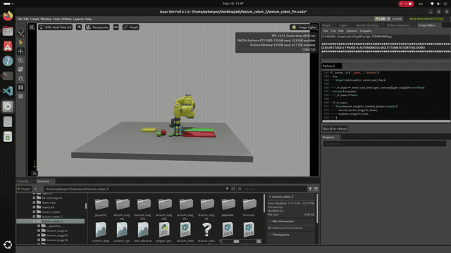
</a>

<br />

<sub>Recorded project footage · click the animation to open the full Isaac Sim video</sub>

<br /><br />

[](https://github.com/ravonek/Lexium_cobot/actions/workflows/offline.yml)
[](https://www.python.org/)
[](isaac_sim/README.md)
[](ros2/README.md)
[](docs/SAFETY.md)
[](docs/STATUS_AND_PROVENANCE.md)

[**Demos**](#-demos) ·
[**Platform**](#-physical-platform) ·
[**Results**](#-recorded-evidence) ·
[**Architecture**](#-system-architecture) ·
[**Quick start**](#-quick-start) ·
[**Roadmap**](#-roadmap)

</div>

---

## The project in one minute

Lexium Agro is a KBTU diploma research project for selective harvesting and
produce sorting in hydroponic greenhouses. The platform combines a **6-axis
Schneider Electric Lexium Cobot**, an **8-wheel omnidirectional mobile base**,
an **RGB-D perception pipeline**, and a **four-finger adaptive gripper**.

The long-term goal is an evidence-driven autonomous cycle:

```text
observe → detect → localize in 3D → plan → approach → grasp → transfer → sort → log
```

<table>
  <tr>
    <td align="center"><strong>6 DOF</strong><br /><sub>Lexium arm</sub></td>
    <td align="center"><strong>8 wheels</strong><br /><sub>omnidirectional base</sub></td>
    <td align="center"><strong>4 fingers</strong><br /><sub>adaptive gripper</sub></td>
    <td align="center"><strong>30 tests</strong><br /><sub>offline suite</sub></td>
    <td align="center"><strong>5 / 5</strong><br /><sub>one recorded Stage 6 scene</sub></td>
  </tr>
</table>

> [!IMPORTANT]
> The repository separates verified offline checks, historical simulation evidence,
> and physical prototype media. A video is not treated as proof of autonomous field
> operation, and an Isaac Lab recording is not treated as proof of a trained policy.

## 🎬 Demos

The previews below are generated directly from the supplied project recordings.
Click any preview to open the original video.

<table>
  <tr>
    <th width="50%">Isaac Sim — scripted manipulation scene</th>
    <th width="50%">Isaac Lab — application recording</th>
  </tr>
  <tr>
    <td align="center">
      <a href="media/videos/Isaac_Sim_2x.mp4">
        
      </a>
    </td>
    <td align="center">
      <a href="media/videos/Isaac_Lab_2x.mp4">
        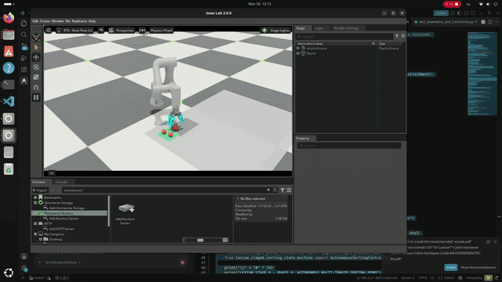
      </a>
    </td>
  </tr>
  <tr>
    <td align="center"><a href="media/videos/Isaac_Sim_original_2026-11-18.mp4">▶ Original-speed video</a></td>
    <td align="center"><a href="media/videos/Isaac_Lab_original_2026-11-18.mp4">▶ Original-speed video</a></td>
  </tr>
</table>

<table>
  <tr>
    <th width="38%">Physical prototype recording</th>
    <th width="62%">Stage 6 recorded final scene</th>
  </tr>
  <tr>
    <td align="center">
      <a href="media/videos/real_robot_phone_video.mp4">
        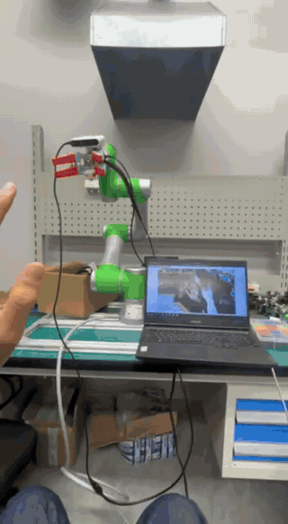
      </a>
    </td>
    <td align="center">
      
    </td>
  </tr>
  <tr>
    <td align="center"><a href="media/videos/real_robot_phone_video.mp4">▶ Open phone recording</a><br /><sub>Prototype bench demo; not autonomous harvesting evidence</sub></td>
    <td align="center"><sub>Supplied simulation screenshot: 5 detected, 5 sorted, 0 remaining</sub></td>
  </tr>
</table>

More supplied recordings are available in [`media/videos`](media/videos/README.md).

## 🤖 Physical platform

<table>
  <tr>
    <td align="center" width="50%">
      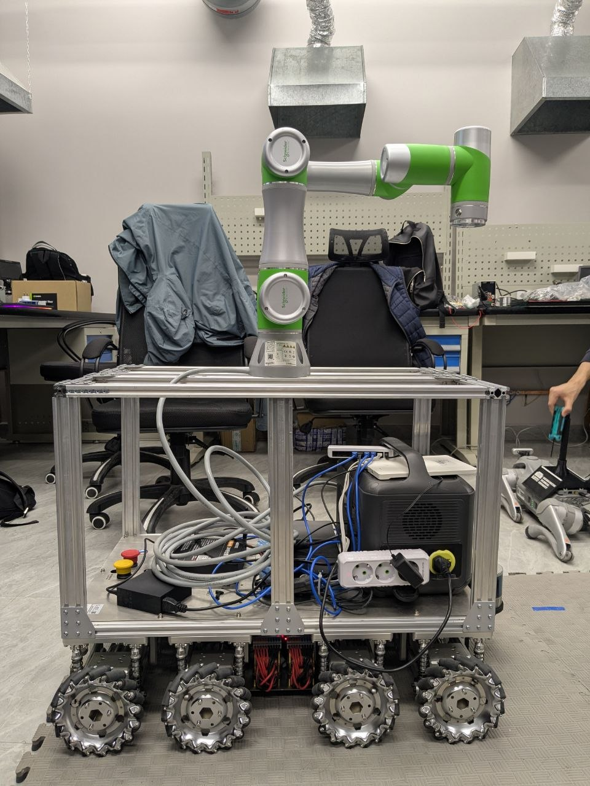
      <br /><sub><b>Mobile manipulator prototype</b><br />Upright arm on an aluminium-profile base</sub>
    </td>
    <td align="center" width="50%">
      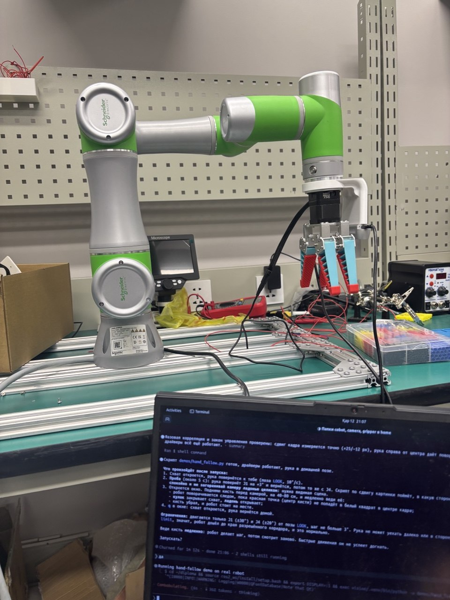
      <br /><sub><b>Four-finger end effector</b><br />Physical gripper integration on the wrist</sub>
    </td>
  </tr>
  <tr>
    <td align="center" width="50%">
      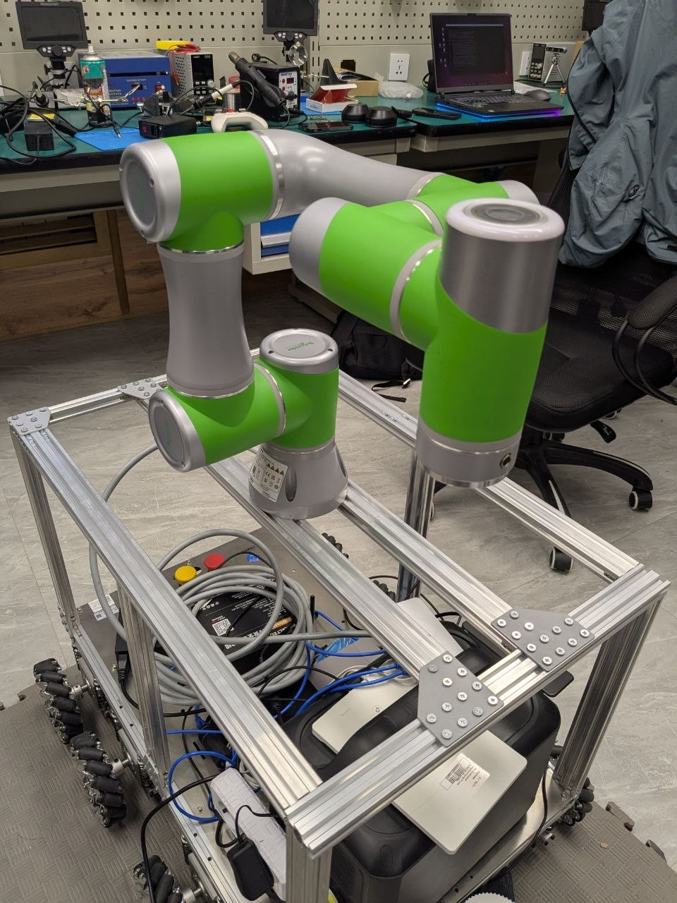
      <br /><sub><b>Mechanical integration</b><br />Arm mounting, frame, cabling, and omni wheels</sub>
    </td>
    <td align="center" width="50%">
      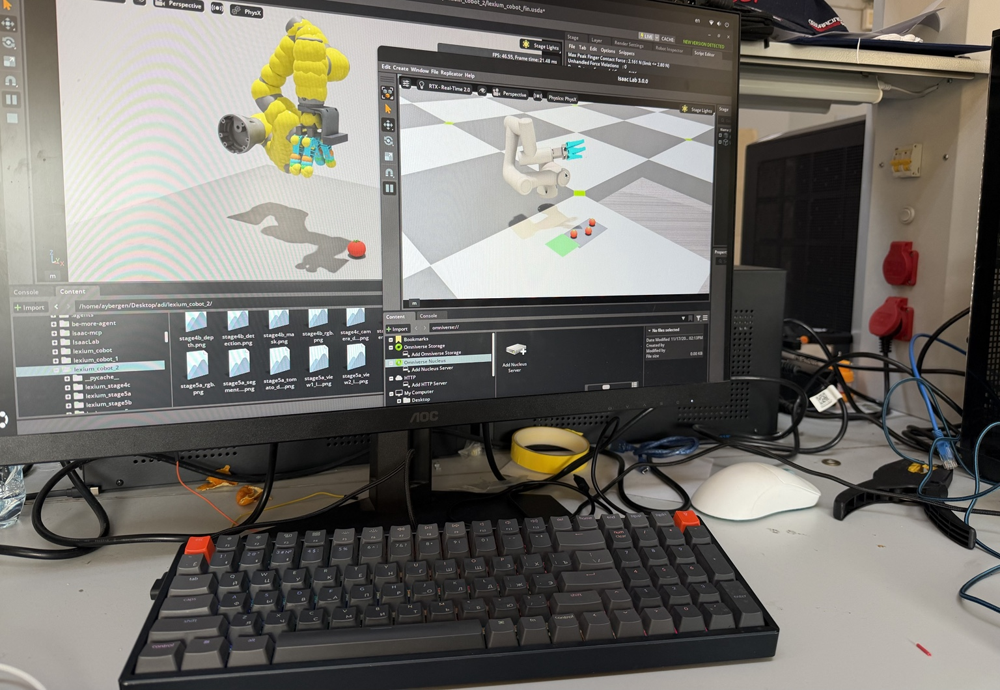
      <br /><sub><b>Simulation workstation</b><br />Development and recorded simulator environment</sub>
    </td>
  </tr>
</table>

| Subsystem | Current evidence | Next validation gate |
|---|---|---|
| Lexium arm + mobile base | Physically assembled and photographed | Controller, limits, stability, and E-stop review |
| Four-finger gripper | CAD, installed prototype, bench media | Calibrated physical force and repeatability study |
| RGB-D perception | Earlier HSV/cube experiments and historical TinyUNet mention | Camera intrinsics, aligned depth, fruit dataset |
| Eye-in-hand calibration | Workflow defined | Lexium-specific transform and held-out residuals |
| Mobile navigation | Platform and architecture exist | Drivers, odometry, localization, and safe stop |

## 📊 Recorded evidence

### Stage 6 — one supplied simulation scene

<table>
  <tr>
    <td align="center" width="50%">
      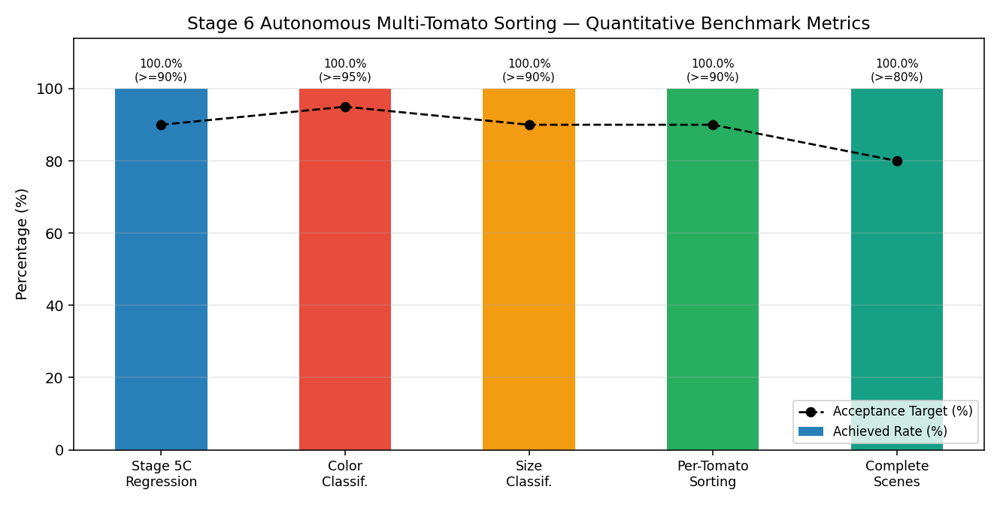
    </td>
    <td align="center" width="50%">
      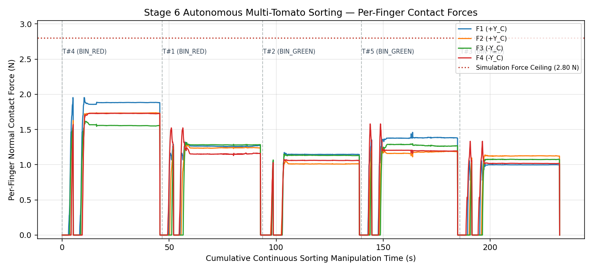
    </td>
  </tr>
  <tr>
    <td align="center"><sub>Displayed benchmark categories and acceptance targets</sub></td>
    <td align="center"><sub>Simulated per-finger force traces and 2.80 N simulation ceiling</sub></td>
  </tr>
</table>

| Recorded overlay | Value | Evidence boundary |
|---|---:|---|
| Objects detected / sorted | **5 / 5** | One supplied simulation scene |
| Remaining objects | **0** | Screenshot transcription |
| Peak force shown | **1.91 N** | Simulated contact overlay |
| Contact / slip state | **VALID / STABLE_GRASP** | Simulated state display |

### Phase 10 — historical terminal transcription

<table>
  <tr>
    <td align="center"><strong>5 / 5</strong><br /><sub>reported validation scenarios</sub></td>
    <td align="center"><strong>10,717</strong><br /><sub>reported trajectory samples</sub></td>
    <td align="center"><strong>0.593 rad/s</strong><br /><sub>reported maximum joint velocity</sub></td>
    <td align="center"><strong>29.98°</strong><br /><sub>reported minimum joint margin</sub></td>
  </tr>
</table>

The Phase 10 source scripts and original raw JSON were not included in the handoff,
so those numbers remain **historical terminal-reported values**, not a fresh rerun.
See [status and provenance](docs/STATUS_AND_PROVENANCE.md) and the
[validation report](docs/VALIDATION_REPORT.md) for the exact distinctions.

## 🧠 System architecture

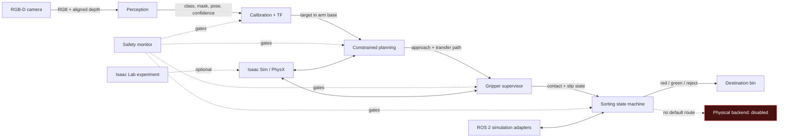

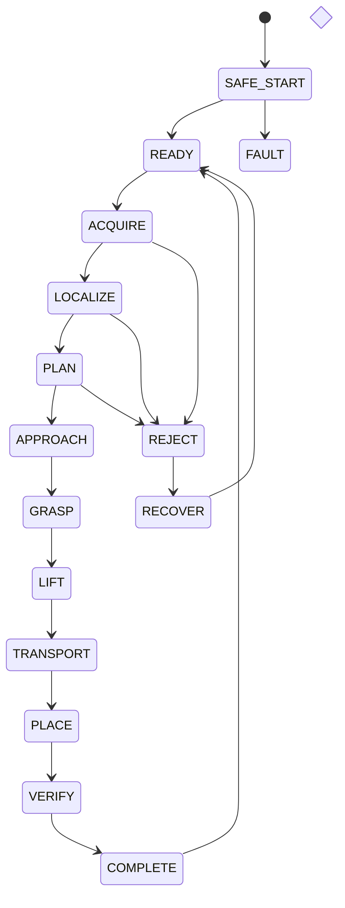

The implemented dependency-light layer contains fail-closed configuration, sorting
decisions, state transitions, RGB-D pinhole geometry, rigid transforms, metrics,
deterministic seeds, structured logging, and a permanently disabled hardware backend.

## 🚀 Quick start

The following workflow is offline-only. It does not import Isaac, ROS, a camera
driver, or a physical robot controller.

```bash
git clone https://github.com/ravonek/Lexium_cobot.git
cd Lexium_cobot

python3 -m venv .venv
.venv/bin/python -m pip install -e '.[dev]'

.venv/bin/python scripts/verify_handoff.py
.venv/bin/python -m ruff check src tests scripts
.venv/bin/python -m mypy src/lexium_agro
.venv/bin/python -m pytest -q
.venv/bin/lexium-agro-dry-run
```

Expected test result at the current revision:

```text
30 passed
```

> These are the new offline repository tests, not the missing historical suite
> described as 20/20 in the Phase 10 transcription.

## 🗺️ Roadmap

| Milestone | State |
|---|---|
| Freeze and hash the supplied handoff | ✅ Complete |
| Offline package, safety gates, tests, typing, and CI | ✅ Complete |
| Import current Ubuntu Stage 6 / Phase 10 workspace | ⏳ Awaiting snapshot |
| Validate latest USD/URDF, meshes, frames, and mounting | ⏳ Pending |
| Reproduce deterministic Isaac Sim baselines | ⏳ Pending |
| Validate RGB-D and eye-in-hand calibration | ⏳ Pending |
| Multi-seed manipulation and sorting benchmark | ⏳ Pending |
| Audit or train a reproducible learned policy | ⏳ Conditional |
| Read-only ROS 2 simulation integration | ⏳ Planned |
| Safety-reviewed physical pilot | 🔒 Separate authorization required |

<details>
<summary><strong>📁 Repository map</strong></summary>

| Path | Purpose |
|---|---|
| [`src/lexium_agro`](src/lexium_agro) | Offline-safe domain layer and typed contracts |
| [`tests`](tests) | Tests runnable without GPU, Isaac, or ROS |
| [`configs`](configs) | Fail-closed defaults; live hardware disabled |
| [`assets/robot`](assets/robot) | Historical robot references awaiting revision validation |
| [`isaac_sim`](isaac_sim) | Simulator integration boundary |
| [`isaac_lab`](isaac_lab) | Experimental learning path; no verified policy claim |
| [`ros2`](ros2) | Planned ROS 2 Jazzy simulation adapters |
| [`legacy`](legacy) | Preserved historical sources, reports, and archives |
| [`evidence`](evidence) | Screenshots and labelled transcriptions |
| [`media`](media) | Photographs, videos, presentations, and documents |
| [`thesis`](thesis) | KBTU thesis draft and figures |
| [`docs`](docs) | Architecture, migration, safety, provenance, and validation |

</details>

<details>
<summary><strong>📦 Recover the current Ubuntu workspace</strong></summary>

The latest Stage 6/Phase 10 sources and raw reports were not present in the handoff.
On the original Ubuntu workstation, run from this repository:

```bash
python3 scripts/collect_workspace.py \
  --workspace "$HOME/Desktop/adi/lexium_rl_workspace/lexium_pick_place" \
  --output "$HOME/Downloads/LEXIUM_CURRENT_WORKSPACE_CODEX.zip"
```

Review `COLLECTION_MANIFEST.json` before sharing. Current robot geometry must never
be silently replaced by older reference assets.

</details>

## 🛡️ Safety boundary

> [!CAUTION]
> This repository is **not approved for live arm or mobile-base control**. Its
> hardware backend intentionally rejects connection and motion commands.

A physical trial requires a separate reviewed procedure, verified robot/tool limits,
validated frames, a guarded workspace, independent emergency stop, competent
supervision, and explicit authorization. Read the complete
[hardware safety policy](docs/SAFETY.md).

## Team

**Sestrevatovskiy Ratmir · Jumashev Tair · Kaldybekov Adilkhan · Maytan Yerassyl**

Supervisor: **Tolengutov Rasul** · Kazakh-British Technical University (KBTU)

## Documentation

[Project specification](PROJECT_SPEC.md) ·
[Architecture](docs/ARCHITECTURE.md) ·
[Provenance](docs/STATUS_AND_PROVENANCE.md) ·
[Validation](docs/VALIDATION_REPORT.md) ·
[Contributing](CONTRIBUTING.md) ·
[Citation](CITATION.cff)

## Licensing notice

No blanket open-source license is granted for bundled CAD, photographs, videos,
historical archives, third-party templates, or vendor-related materials. Review
[LICENSE-NOTICE.md](LICENSE-NOTICE.md) before redistributing project assets.

---

<div align="center">

### Simulation first · evidence before claims · safety before motion

<sub>Lexium Agro — KBTU autonomous mobile manipulation research</sub>

</div>
